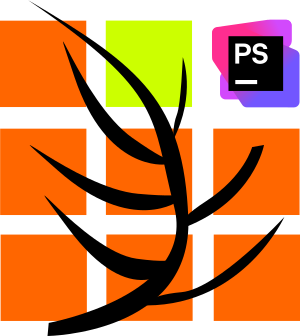

# Small Entity Manager — PhpStorm plugin

Native PhpStorm 2025.1+ plugin for Small Swoole Entity Manager Core 3 and its Symfony Bundle. Unlike the shared PHP CLI engine, **the PhpStorm plugin does not require PHP, Composer, a configured PHP interpreter or a running application**. It reads source files statically in the background and does not execute application PHP.

## Features

- Completion dropdown inside query string arguments: mapped entity fields, relations, join aliases, scalar projections, named parameters.
- Completion of manager-class references in a factory call: start typing \`$factory->get(Us\` and press **Ctrl+Space** to insert a qualified \`Manager::class\`.
- Type inference through PhpStorm's **PhpTypeProvider4**, including \`$factory->get(UserManager::class)\` and the relevant Small query-builder, join and condition types.
- Imported and aliased class names, grouped imports, local traits, ancestor entity properties, fluent calls, named arguments and stored query builders.
- Native bounded indexing: skips vendor, node_modules, build outputs and generated directories, limits files to 2 MiB and 10,000 source files, caches results and completes asynchronously.
- No PHP process, shell command, Composer autoload or SQL connection is invoked.

## Installation

In PhpStorm: **Settings → Plugins → gear icon → Install Plugin from Disk**. Select the plugin ZIP from the \`phpstorm_build\` CI artifact or the GitLab release.

No PHP installation on Windows is required for these completion and inference features. Normal PhpStorm PHP debugging, PHPUnit and code execution still need a configured interpreter as usual.

## Build

\`\`\`sh
cd phpstorm
gradle --no-daemon test buildPlugin
\`\`\`

Uses Gradle 9.2.1, JDK 21 and the official PhpStorm 2025.1.3 SDK with its bundled PHP plugin. JetBrains' runtime PHP PSI APIs are provided by PhpStorm and are **not** packaged inside our plugin.

Output: \`build/distributions/small-entity-manager-phpstorm-<version>.zip\`.

Tagged builds take their version from \`CI_COMMIT_TAG\`. The branch development version is \`0.2.5-dev-2\`.

## Query example

\`\`\`php
use Demo\EntityManager\UserManager;

/** @var \Small\SwooleEntityManager\Factory\EntityManagerFactory $factory */
$manager = $factory->get(UserManager::class);
$query = $manager->createQueryBuilder('user');
$query->leftJoin('user', 'company', 'owner')->endJoin();
$query->getFieldForCondition(''); // Ctrl+Space: id, email, companyId, createdAt
$query->getFieldForCondition('name', 'owner');
\`\`\`

**Signatures matter:** Core 3 factory uses \`get(string $manager, bool $new = false)\` whereas Symfony Bundle factory uses \`get(string $managerClass, bool $new = false)\`. Prefer positional \`get(UserManager::class)\` if the same source is intended for both. The plugin understands \`manager:\` and \`managerClass:\`, but it does not change those PHP signatures.

For conditions, the correct first argument to \`firstCondition()\` may be a \`ConditionField\` from \`getFieldForCondition()\`; the second argument is a \`ConditionOperatorType\` value. The plugin does not inject false field names directly into \`firstCondition()\` string arguments.

## Tests / stability

Kotlin unit and regression tests exercise native indexing from the PHP fixture files, manager resolution, join aliases, type inference, and avoidance of unrelated factory calls. GitLab builds the plugin with the **real** JetBrains PHP API.

The completion contributor is non-blocking; the initial Ctrl+Space invocation may schedule the scan, then reopen completion when data is available. On installations with automatic popups disabled, invoke Ctrl+Space a second time.

This is conservative static source analysis. Files with unsupported dynamic attributes or runtime-computed class names may not yield completions; completion results are refreshed after about 30 seconds.

## Deployment status

Passing Kotlin tests and successful plugin packaging verify bytecode compilation against the official SDK; they **do not** replace a runtime smoke test on an actual Windows PhpStorm instance. Test installation and real-editor completion before publishing a stable release.
